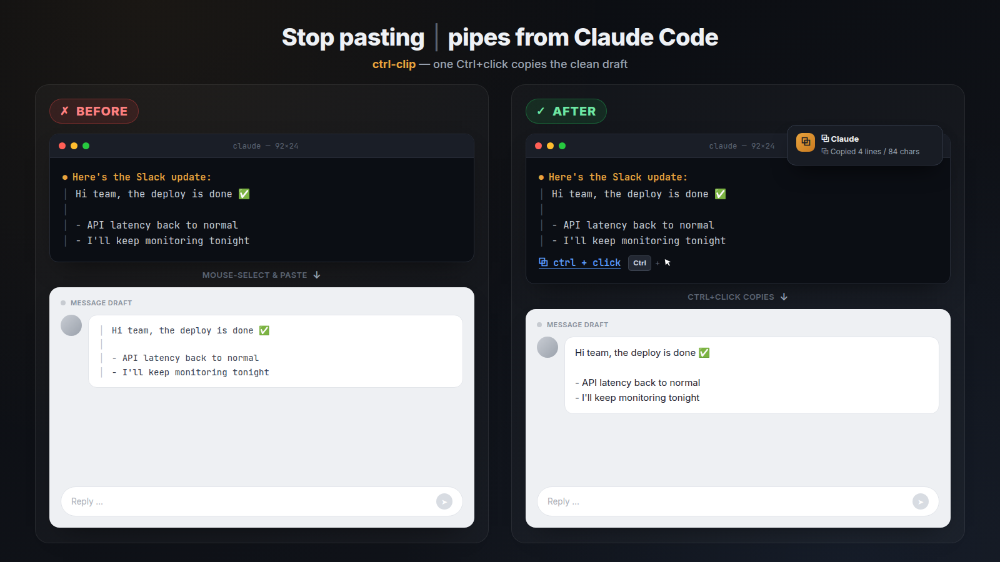
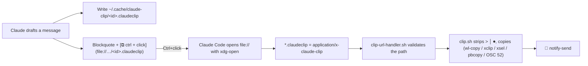

# ⧉ ctrl-clip — paste Claude Code drafts without the `│` pipes

[](https://github.com/geanruca/ctrl-clip/actions/workflows/ci.yml)
[](LICENSE)
[](skills/ctrl-clip/SKILL.md)
[](.claude-plugin/plugin.json)

Claude Code shows every message it drafts for you (a Slack reply, a PR description, an
email) as a blockquote. In the terminal that is a vertical bar on every line, and when
you select the text and paste it, **the bars come along**.

**ctrl-clip** puts a `⧉ ctrl + click` link under each draft. Ctrl+click it and the clean text
lands on your clipboard: no `│`, no `>`, no "Here's a draft:" commentary. A desktop
notification confirms the copy.



## Before / after

### A Slack update

**Before**: what Claude Code shows, and what you get when you select it and paste:

```text
⏺ Here's the Slack update:

  │ Hi team, the deploy is done ✅
  │
  │ - API latency is back to normal
  │ - I'll keep monitoring tonight
```

```text
│ Hi team, the deploy is done ✅
│
│ - API latency is back to normal
│ - I'll keep monitoring tonight
```

**After**: the same draft, with the copy link underneath:

```text
⏺ Here's the Slack update:

  │ Hi team, the deploy is done ✅
  │
  │ - API latency is back to normal
  │ - I'll keep monitoring tonight

  ⧉ ctrl + click
```

Ctrl+click, then paste:

```text
Hi team, the deploy is done ✅

- API latency is back to normal
- I'll keep monitoring tonight
```

🔔 `⧉ Claude — ⧉ Copied 4 lines / 84 chars`

### A PR description (`/ctrl-clip md`)

**Before**: `/copy` copies the raw markdown of the whole last response, commentary included:

```text
Here's a PR description you can use:

> ## Fix flaky login test
>
> - Wait for the session cookie before asserting
> - Remove the fixed `sleep(2)`

Let me know if you want it shorter!
```

**After**: only the draft, as Markdown that GitHub renders:

```markdown
## Fix flaky login test

- Wait for the session cookie before asserting
- Remove the fixed `sleep(2)`
```

### A table, formatted for chat (`/ctrl-clip slack`)

**Before**: a Markdown table pasted into Slack stays raw text:

```text
│ | Service | Status | p95   |
│ |---------|--------|-------|
│ | api     | ✅ up  | 120ms |
│ | worker  | ⚠ slow | 2.4s  |
```

**After**: one line per row, readable anywhere:

```text
api: ✅ up, 120ms
worker: ⚠ slow, 2.4s
```

### An email body (`/ctrl-clip plain`)

**Before**: `**bold**`, backticks and `>` markers end up in the email.
**After**: no markup at all. Bullets become `- ` and the paragraphs stay as they were.

## Install

Pick **one** channel. (Internal names keep the `claude-clip` prefix: the `.claudeclip` extension, `~/.cache/claude-clip` and the `application/x-claude-clip` MIME type.) With any of them, ctrl-clip is **on by default** (autoload): every
session loads a short rule, so every draft gets its copy link without you typing
`/ctrl-clip`.

### 1. Claude Code plugin (recommended)

Inside Claude Code:

```text
/plugin marketplace add geanruca/ctrl-clip
/plugin install ctrl-clip@ctrl-clip
```

Restart Claude Code. The plugin ships a `SessionStart` hook that registers the Ctrl+click
handler (idempotent, and repeated after plugin updates) and loads the autoload rule
with your real paths.

### 2. One-line installer

Run it from a terminal **on the desktop where Claude Code runs**. It works from any shell
you use, because the installer runs under bash regardless of your login shell:

| Your shell | Command |
|---|---|
| bash / zsh / ksh / sh | `curl -fsSL https://raw.githubusercontent.com/geanruca/ctrl-clip/main/install.sh \| bash` |
| fish | `curl -fsSL https://raw.githubusercontent.com/geanruca/ctrl-clip/main/install.sh \| bash` |
| nushell | `http get https://raw.githubusercontent.com/geanruca/ctrl-clip/main/install.sh \| bash` |
| PowerShell (pwsh on Linux) | `curl -fsSL https://raw.githubusercontent.com/geanruca/ctrl-clip/main/install.sh \| bash` |
| tcsh / csh | `curl -fsSL https://raw.githubusercontent.com/geanruca/ctrl-clip/main/install.sh \| bash` |

Or from a clone: `git clone https://github.com/geanruca/ctrl-clip && cd ctrl-clip && ./install.sh`.

The installer:

1. checks for a desktop session, `xdg-utils`, `shared-mime-info`,
   `desktop-file-utils`, `libnotify` and `xclip` (X11) or `wl-clipboard` (Wayland),
   and prints the `apt`/`dnf`/`pacman`/`zypper` command for anything missing (it never
   runs `sudo` for you)
2. copies the skill to `~/.claude/skills/ctrl-clip` (honors `CLAUDE_CONFIG_DIR`)
3. registers `*.claudeclip` → `application/x-claude-clip` → `clip-url-handler.sh`
4. adds the autoload rule to `~/.claude/CLAUDE.md` inside a managed block (skip it with
   `--no-autoload`)
5. runs an end-to-end self-test with the real `xdg-open` and clipboard, then restores
   your clipboard (skip it with `--no-test`)

### 3. skills.sh / other skill managers

```bash
npx skills add geanruca/ctrl-clip
bash ~/.claude/skills/ctrl-clip/clip-setup.sh --claude-md   # register the handler + autoload rule
```

The `skills` CLI needs Node.js 20.12 or newer. Without the second line, Claude still registers the handler the first time it uses the
skill. But then ctrl-clip only kicks in when Claude decides to invoke it, instead of on every
draft.

### Requirements

- Linux desktop session (X11 or Wayland) where Claude Code runs. Over plain SSH it
  can't work: `xdg-open` and the clipboard would act on the remote machine.
- `xdg-utils`, `shared-mime-info`, `desktop-file-utils`, `libnotify` (optional) and
  `xclip`/`xsel` (X11) or `wl-clipboard` (Wayland).
- Claude Code with `"tui": "fullscreen"` in `~/.claude/settings.json`. The flow is
  verified in this mode.

**Verified setup:** Ubuntu (X11), GNOME Terminal, Claude Code 2.1.270 in fullscreen
mode, xclip. Wayland, other terminals, KDE and other distros *should* work, since
everything goes through freedesktop standards. Please open an issue with your result.

## Usage

- **Automatic**: ask Claude to draft anything you'll paste. It shows the draft as a
  blockquote with `⧉ ctrl + click` underneath. **Ctrl+click** it (a plain click does
  nothing).
- **Manual**: `/ctrl-clip` copies the latest draft right away (with the plugin:
  `/ctrl-clip:ctrl-clip`).
  - `/ctrl-clip md`: Markdown, for PR descriptions and GitHub/Azure DevOps comments
  - `/ctrl-clip plain`: no markup, for email bodies and forms
  - `/ctrl-clip slack the second draft`: pick what to copy (the default format is `slack`:
    `*bold*`, `_italic_`, tables flattened to lines)

## How it works



Why a `file://` link instead of a custom `claude-clip://` URL scheme? In fullscreen
mode, Claude Code only dispatches clicks on a fixed allowlist of schemes (http, https,
vscode, slack, …) and on local `file://` paths, which it opens with `xdg-open`. A
custom scheme is silently dropped, so ctrl-clip registers a **file type** instead.

| File | Role |
|---|---|
| [`skills/ctrl-clip/SKILL.md`](skills/ctrl-clip/SKILL.md) | The skill: what to copy, how to format it for Slack, Markdown or plain text, and the inline link |
| [`skills/ctrl-clip/clip.sh`](skills/ctrl-clip/clip.sh) | Cleans the text and copies it with the first backend that works |
| [`skills/ctrl-clip/clip-url-handler.sh`](skills/ctrl-clip/clip-url-handler.sh) | The desktop handler `xdg-open` launches; validates the path, copies, notifies |
| [`skills/ctrl-clip/clip-setup.sh`](skills/ctrl-clip/clip-setup.sh) | Registers the MIME type and desktop file, writes the autoload rule, runs the self-test, uninstalls |
| [`hooks/hooks.json`](hooks/hooks.json) | Plugin `SessionStart` hook: autoload |
| [`install.sh`](install.sh) | Standalone installer |

## Shell compatibility

ctrl-clip never runs through your interactive shell. Every script is an executable with a
`#!/usr/bin/env bash` shebang: Claude Code calls it by path, and the desktop calls it
through `xdg-open`. So it behaves the same whether your login shell is bash, zsh, fish,
nushell or PowerShell. CI proves it on every push by piping drafts into `clip.sh`,
calling the handler and running the `curl … | bash` installer **from each shell's own
syntax**:

<!-- shells-table:begin -->
| Shell | Version | pipe → clip.sh | clip.sh FILE | Ctrl+click handler | curl … \| bash install |
|---|---|:-:|:-:|:-:|:-:|
| bash | 5.2.21 | ✅ | ✅ | ✅ | ✅ |
| zsh | 5.9 | ✅ | ✅ | ✅ | ✅ |
| fish | 3.7.0 | ✅ | ✅ | ✅ | ✅ |
| dash (sh) | 0.5.12 | ✅ | ✅ | ✅ | ✅ |
| ksh | 93u+m/1.0.8 | ✅ | ✅ | ✅ | ✅ |
| mksh | R59 | ✅ | ✅ | ✅ | ✅ |
| tcsh | 6.24.10 | ✅ | ✅ | ✅ | ✅ |
| nushell | 0.115.1 | ✅ | ✅ | ✅ | ✅ |
| PowerShell (pwsh) | 7.6.5 | ✅ | ✅ | ✅ | ✅ |
| elvish | 0.20.1 | ✅ | ✅ | ✅ | ✅ |
| xonsh | 0.24.2 | ✅ | ✅ | ✅ | ✅ |

Each cell runs the shell's own syntax, for example `cat $DRAFT | $CLIP` in fish,
`open --raw $env.DRAFT | ^$env.CLIP` in nushell and `Get-Content -Raw $env:DRAFT | & $env:CLIP`
in PowerShell. The clipboard must then match the expected clean text byte for byte
([`tests/shells.sh`](tests/shells.sh)). The table is the output of the `shell compatibility`
CI job on Ubuntu, which also writes it to the job summary.

<!-- shells-table:end -->

The `clip.sh` cleaner also runs on macOS (BSD `sed`, bash 3.2, zsh) with `pbcopy`. The
Ctrl+click link itself is Linux-only, because it relies on freedesktop MIME types.

## Troubleshooting

| Symptom | Check |
|---|---|
| Clicking the link does nothing | Use **Ctrl**+click. Does the link look like a link, or like the raw `(file://…)` path? Plain click is ignored by design |
| Still nothing | `tail ~/.cache/claude-clip/handler.log`. No new entry means the click never reached the handler: run `~/.claude/skills/ctrl-clip/clip-setup.sh --check` |
| Log entry but clipboard unchanged | Clipboard backend: on Wayland install `wl-clipboard`, on X11 `xclip` |
| Opens a text editor instead of copying | MIME registration: `xdg-mime query default application/x-claude-clip` should print `claude-clip-url-handler.desktop`; rerun `clip-setup.sh` |
| Draft shows no link | Autoload rule missing: `clip-setup.sh --claude-md`, or install the plugin |

## Uninstall

```bash
./install.sh --uninstall        # or: curl -fsSL …/install.sh | bash -s -- --uninstall
/plugin uninstall ctrl-clip@ctrl-clip   # plugin users, then: clip-setup.sh --uninstall
```

## Security

- The handler only accepts regular files named `[A-Za-z0-9_-]{1,64}.claudeclip`
  directly inside `~/.cache/claude-clip` (mode `700`). It rejects other paths,
  `..` tricks and symlinks, and logs every invocation.
- Nothing leaves your machine: no network access, no telemetry.

## Contributing

Issues and PRs are welcome, especially reports from Wayland, KDE, other terminals and
distros.

```bash
make test         # unit + shell matrix + integration (integration needs a desktop session)
make lint         # shellcheck
```

## Related projects

- [octavehq/claude-clip](https://github.com/octavehq/claude-clip): a macOS `/clip md|slack|plain|html` skill that has Claude re-type its last message through a Python reformatter into `pbcopy`. ctrl-clip copies only the draft, without a second model turn, runs on Linux desktops, and adds the Ctrl+click link.
- Codex CLI added a `/copy` target picker that can copy a single blockquote ([openai/codex#39997](https://github.com/openai/codex/pull/39997)).
- The same need upstream in Claude Code: [#63496 Click-to-copy affordance on agent-designated content](https://github.com/anthropics/claude-code/issues/63496) and [#80979 Blockquote markers cause vertical lines in copied text](https://github.com/anthropics/claude-code/issues/80979), both closed.

## License

[MIT](LICENSE)
